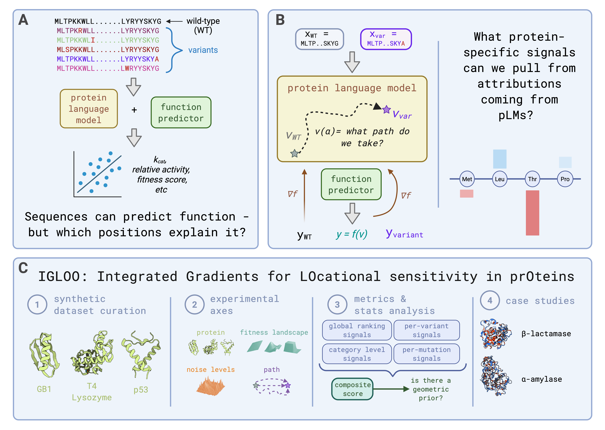

🧊 IGLOO
========

**Integrated Gradients for LOcational sensitivity in prOteins**

.. image:: https://img.shields.io/badge/python-3.11%20%7C%203.12-blue.svg
        :target: https://www.python.org/downloads/
        :alt: Python Version

.. image:: https://img.shields.io/badge/license-MIT-blue.svg
        :target: https://github.com/ranaabarghout/IGLOO/blob/main/LICENSE
        :alt: License

IGLOO is a pipeline for checking how good attributions are on protein fitness landscapes.
It trains regression heads on protein language model (pLM) embeddings and computes
per-residue attributions: Integrated Gradients (IG) along configurable interpolation
paths, plus gradient×input, input-difference and in-silico mutagenesis (ISM) baselines.
It then scores those attributions against known ground truth on synthetic landscapes,
and applies the same pipeline to real datasets (FLIP2, ProteinGym).

.. contents:: **Contents**
   :local:
   :depth: 1

Key features
------------

**Models**
   * Pluggable pLM backbones: **ESM-C** (300M / 600M), **ESM-2**, **Ankh** (base / large,
     including intermediate layers), **Profluent E1** (150M / 300M / 600M), and a
     **one-hot** no-pLM baseline.
   * Interchangeable regression heads (``model.pooling_method``): attention pooling
     (*Pool First*), per-residue MLP before pooling (*PreMLP*), per-residue mean pooling
     (*MeanPool*), and per-residue attention pooling (*AttnPool*).
   * K-fold training with early stopping, controllable label noise (to make
     deliberately worse models), and seeded runs for ensembles.

**Attribution methods**
   * Embedding-level IG with ``linear``, ``slerp``, ``nearest_neighbor`` and ``guided_ig``
     interpolation paths, with completeness-axiom checks.
   * Non-path baselines: ``gradient_x_input`` and ``input_difference``.
   * In-silico mutagenesis (ISM) as a baseline that depends on the trained model.
   * Token-level IG through the full ESM-C model (pilot).

**Benchmarking**
   * Synthetic ground-truth landscapes for GB1, T4 Lysozyme and p53, each in three
     types: *additive*, *epistatic* and *nonlinear*.
   * A metric suite (NDCG, AUROC, precision@k, sign accuracy, …) combined into a single
     TOPSIS score, plus label-noise sweeps relating attribution quality to model quality.
   * Sanity checks: cascading parameter randomization (Adebayo et al.), factor ablation,
     and k-predictor agreement.
   * Ensembles of attributions across seeds, and publication-ready figures.

Repository layout
-----------------

.. code-block:: text

    IGLOO/
    ├── src/igloo/           # Core library (models, embeddings, IG, metrics, plotting)
    ├── scripts/             # Command-line entry points, grouped by stage
    │   ├── pipeline/        #   train + attribute (start here)
    │   ├── data/            #   generate datasets and configs
    │   ├── evaluation/      #   score attributions (metric suite, TOPSIS, ensembles)
    │   ├── sanity_checks/   #   randomization, factor ablation, k-predictor tests
    │   ├── figures/         #   paper and diagnostic figures
    │   ├── e15_crossplm/    #   E15 cross-pLM experiment (historical)
    │   ├── utils/           #   tracker and config-validation helpers
    │   └── archive/         #   superseded one-off scripts
    ├── jobs/                # Slurm batch scripts, grouped by experiment
    │   ├── cache/  synthetic/  architectures/  backbones/  attribution/
    │   ├── analysis/  real_proteins/  smoketests/  maintenance/  e15_crossplm/
    │   └── logs/            #   Slurm stdout/stderr (git-ignored)
    ├── configs/             # YAML run configs (synthetic/, FLIP2/, ProteinGym/)
    ├── data/                # Input datasets + embedding cache (data/embeddings/)
    ├── results/             # All run outputs
    ├── docs/                # Detailed documentation (start at docs/README.md)
    ├── tests/               # pytest suite
    └── vendor/E1/           # Vendored Profluent E1 package (separate venv)

The full catalogue of every script and job, with what each one does, is in
`docs/README.md <docs/README.md>`_.

Installation
------------

**Requirements:** Python 3.11 or 3.12. A CUDA GPU is required for training and
attribution (development used H100 / L40S slices). Analysis and figure scripts run on CPU.

On a Digital Research Alliance of Canada cluster
~~~~~~~~~~~~~~~~~~~~~~~~~~~~~~~~~~~~~~~~~~~~~~~~

Use the module system and the Alliance wheelhouse. Every dependency except ``ankh`` is
available there.

.. code-block:: bash

    cd /path/to/IGLOO
    module load python/3.11 gcc arrow cuda/12.2

    # Keep venvs in $HOME: they hold many small files, and /project has a tight inode quota
    virtualenv --no-download ~/IGLOO_env
    source ~/IGLOO_env/bin/activate
    pip install --no-index --upgrade pip
    pip install --no-index -e .          # IGLOO + dependencies from the wheelhouse
    pip install ankh                     # not in the wheelhouse; needs internet (login node)

    ln -s ~/IGLOO_env IGLOO_env          # the job scripts expect ./IGLOO_env

**Profluent E1 backbones only.** E1 needs Python 3.12 and its own environment:

.. code-block:: bash

    module load python/3.12 gcc arrow cuda/12.2
    virtualenv --no-download ~/IGLOO_env_e1
    source ~/IGLOO_env_e1/bin/activate
    pip install --no-index -e .
    pip install -e vendor/E1
    ln -s ~/IGLOO_env_e1 IGLOO_env_e1

Run anything heavier than ``--validate-only`` inside a job (``sbatch``) or an interactive
allocation (``salloc``), never on a login node.

On a local workstation
~~~~~~~~~~~~~~~~~~~~~~

.. code-block:: bash

    git clone https://github.com/ranaabarghout/IGLOO.git
    cd IGLOO
    python3.11 -m venv IGLOO_env && source IGLOO_env/bin/activate
    pip install -e . ankh

Check the installation
~~~~~~~~~~~~~~~~~~~~~~

.. code-block:: bash

    python health_check.py
    python scripts/pipeline/run_integrated_gradients.py \
        configs/synthetic/GB1_additive_config.yaml --validate-only

Quick start
-----------

All commands run from the repository root. The synthetic datasets in ``data/synthetic/``
are already committed, so you can start at step 2.

**1. (Optional) Regenerate the synthetic landscapes**

.. code-block:: bash

    python scripts/data/generate_synthetic_datasets.py

**2. Train a model and compute attributions** (GPU)

.. code-block:: bash

    python scripts/pipeline/run_integrated_gradients.py configs/synthetic/GB1_additive_config.yaml

Any config value can be overridden from the command line with ``key.subkey=value``.
Overrides are how the job arrays sweep backbones, heads, noise levels and seeds:

.. code-block:: bash

    python scripts/pipeline/run_integrated_gradients.py configs/synthetic/GB1_additive_config.yaml \
        model.esm_model_name=esmc_300m \
        model.pooling_method=esm_perres_mean \
        integrated_gradients.interpolation_path=linear \
        training.noise.label_noise_mode=blend training.noise.label_noise_level=0.35 \
        training.seed=1 training.noise.label_noise_seed=1 \
        model_dir=results/synthetic/demo/model results_dir=results/synthetic/demo/linear

Add ``--skip-ig`` to train and evaluate without computing attributions.

**3. Score the attributions**

.. code-block:: bash

    python scripts/evaluation/metric_suite.py --root results/synthetic

**4. Run sanity checks and baselines** (GPU, on an already trained run)

.. code-block:: bash

    python scripts/pipeline/ism_attribution.py --run-dir <run_dir> --model-dir <model_dir>
    python scripts/sanity_checks/cascading_randomization.py --run-dir <run_dir> --model-dir <model_dir>

**5. Make figures**

.. code-block:: bash

    python scripts/figures/make_poolfirst_topsis_figure.py
    python scripts/figures/export_final_figures_nature_methods.py

Each stage, the scripts that belong to it, and the matching Slurm jobs are described in
`docs/README.md <docs/README.md>`_.

Running on Slurm
----------------

The batch scripts in ``jobs/`` ``cd`` to the repository root, activate ``IGLOO_env``,
and write logs to ``jobs/logs/``. Submit them from the repository root:

.. code-block:: bash

    sbatch jobs/cache/rebuild_warm_cache_newbackbones.sh     # warm the embedding cache first
    sbatch jobs/backbones/run_plm_backbone_train_array.sh    # then the training/attribution array
    sbatch jobs/analysis/run_analysis.sh                     # then the CPU analysis suite

Before reusing a job script, check its header for ``--account``, the hard-coded ``cd``
path, and the GPU type. Several older scripts still point at paths from earlier clusters
(``/project/aip-bensl``, ``/scratch``).

Training arrays read embeddings from the content-addressed cache
``data/embeddings/by_seq/<model>/L<layer>/``. Warm it with a ``jobs/cache/`` script first,
so that hundreds of array tasks don't each recompute the same embeddings.

Configuration
-------------

Each run is defined by one YAML file:

.. code-block:: text

    configs/
    ├── synthetic/     # GB1 / T4Lysozyme / p53 × additive / epistatic / nonlinear
    ├── FLIP2/         # alpha-amylase splits
    ├── ProteinGym/    # one config per DMS assay (generated by scripts/data/generate_proteingym_configs.py)
    └── *.yaml         # legacy real-data configs (beta-lactamase, ERBC, PafA)

The main sections are ``data`` (CSV path, target column, wild-type definition), ``model``
(backbone, layer, pooling head, training hyperparameters), ``integrated_gradients``
(method, interpolation path, steps), ``analysis.sequence_selection``, and ``training``
(seeds, folds, label/input noise). ``results_dir``, ``model_dir`` and ``force_retrain``
control where outputs go and whether to reuse a trained model. The full schema is in
`configs/README.md <configs/README.md>`_.

======================  ======================================================================
Option                  Values
======================  ======================================================================
``esm_model_name``      ``esmc_300m`` (default), ``esmc_600m``, ``esm2_*``, ``ankh_base``,
                        ``ankh_large``, ``e1_150m``, ``e1_300m``, ``e1_600m``, ``onehot``
``pooling_method``      ``esm_attention`` (Pool First), ``esm_attention_premlp`` (PreMLP),
                        ``esm_perres_mean`` (MeanPool), ``esm_perres_attn`` (AttnPool);
                        experimental: ``esm_attention_channel``, ``esm_mutation_pool``,
                        ``esm_perres_flatten``, ``esm_crossattn_perres``
``interpolation_path``  ``linear``, ``slerp``, ``nearest_neighbor``, ``guided_ig``
======================  ======================================================================

Core library (``src/igloo/``)
-----------------------------

* ``igloo.py``: top-level class that runs training and IG
* ``esm_adapter.py``: one loader for the ESM-C, ESM-2, Ankh and E1 backends
* ``embedding.py``: embedding extraction and the ``by_seq`` cache
* ``models.py``: regression heads (all ``pooling_method`` variants)
* ``train_and_eval.py``: K-fold training, early stopping, Pearson/Spearman evaluation
* ``data_processing.py`` / ``dataset.py``: loading, normalisation, label noise, splits
* ``integrated_gradients.py``, ``sequence_ig.py``, ``advanced_ig.py``: IG and interpolation paths
* ``completeness_validation.py``: completeness-axiom checks
* ``mutagenesis.py``: in-silico mutagenesis
* ``ig_metrics.py``, ``method_selection.py``: attribution-quality metrics and ranking
* ``synthetic_data.py``: synthetic landscape generation
* ``config_utils.py``: YAML loading, validation and CLI overrides
* ``plot.py``: plotting helpers

Results layout
--------------

.. code-block:: text

    results/synthetic/
    ├── seedsweep/<protein>_<landscape>/noise_<N>/seed_<S>/      # Pool First (IG) runs
    ├── premlp/ | newarch_perres_mean/ | newarch_perres_attn/ | onehot/   # other heads (esmc_300m)
    ├── <pooling_method>_<backbone>/                             # backbone comparison
    ├── meanpool_ankh_base_layersweep/                           # Ankh intermediate-layer sweep
    ├── ism_attribution/  cascading_randomization*/  factor_ablation_analysis/
    ├── metric_suite/                                            # metrics + TOPSIS tables/figures
    └── final_figures_nature_methods/                            # curated paper figures
    results/FLIP2/   results/ProteinGym/                         # real-protein runs

Tests
-----

.. code-block:: bash

    pytest tests/

License
-------

MIT License (see `LICENSE <docs/LICENSE>`_).

Acknowledgments
---------------

* ESM-C protein language models by EvolutionaryScale
* Ankh protein language models (Elnaggar et al.)
* Profluent E1 protein language models by Profluent Bio
* PyTorch and Captum for attribution infrastructure
* FLIP2 and ProteinGym benchmark datasets

Support
-------

* `Report issues <https://github.com/ranaabarghout/IGLOO/issues>`_
* `Discussions <https://github.com/ranaabarghout/IGLOO/discussions>`_
* `Contact <mailto:ranamoneim@gmail.com>`_

**Citation**: if you use IGLOO in your research, please cite our work (citation details coming soon).
